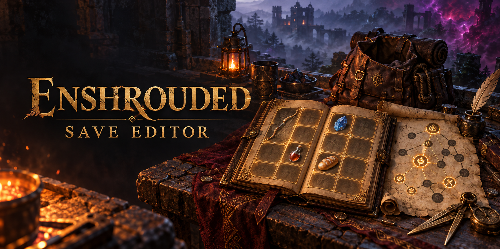

<p align="center">
  
</p>

<h1 align="center">Enshrouded Save Editor</h1>

<p align="center">
  <b>Редактор персонажа Enshrouded с интерфейсом, как в самой игре.</b><br>
  Рюкзак, экипировка, дерево навыков, камни и знания — в локальных сейвах и на выделенном сервере.
</p>

<p align="center">
  <a href="../../releases/latest"></a>
  <a href="../../actions/workflows/build.yml"></a>
  
  
  <a href="LICENSE"></a>
</p>

<p align="center">
  🇺🇸 <a href="README.md">English</a> · 🇧🇷 <a href="README.pt-BR.md">Português</a> · 🇷🇺 Русский
</p>

---


**Изменения:** см. [changelog](CHANGELOG.md) (английский).

## ✨ Что умеет

| | |
|---|---|
| 🧙 **Персонаж** | уровень и опыт; **настоящее** дерево навыков, с раскладкой и позициями из игры — и отказ сохранить дерево, которое игра отвергнет (иначе она вернёт все очки) |
| 🎒 **Рюкзак** | 40 ячеек, панель ALT и панель действий на своих местах; контейнер надетого рюкзака в реальном размере; каталог всех предметов, перетаскивание, дублирование, удаление; фильтры по категории, редкости и тиру |
| 🛡️ **Экипировка** | кукла на все 16 слотов (броня, внешний вид, кольца, щит, крюк, планер, рюкзак) — рюкзак с вещами внутри снять нельзя |
| 💎 **Любой предмет подробно** | уровень, количество, прочность, улучшения, редкость и **камень в оружии** (заменить, снять, сменить уровень) |
| ⚔️ **Что делает предмет** | строки характеристик и усиления по уровню улучшения, прочитанные из ресурсов игры и показанные так же, как в ней |
| 📜 **Знания** | открытия и рецепты, поиск по имени или id, фильтр по уровню |
| 🏰 **Выделенный сервер** | вместе с [Enshrouded Server Guardian](https://github.com/nicolasferreiraxn/Enshrouded-Server-Guardian) копии персонажей с сервера в том же списке — правка, кик, и игрок заходит уже с вашей версией |
| 💾 **Всегда есть бэкап** | копия перед каждой записью, восстановить можно из самого редактора |
| 🌍 **Португальский и английский** | переключение на нижней панели; новый язык интерфейса — один JSON-файл |

Каждый новый предмет создаётся с теми дополнительными полями, которые этот тип реально хранит в сейве — поэтому
созданное в редакторе работает в игре.

## 🚀 С чего начать

1. Скачайте **`enshrouded-save-editor.exe`** со страницы **[Releases](../../releases/latest)**.
2. Запустите. Ставить ничего не нужно — всё внутри исполняемого файла.
3. Выберите сейв и правьте. **Ctrl+S** записывает (сначала делает бэкап).

> ⚠️ Правьте при **закрытой игре**. Пока она запущена, она перезаписывает сейв.

## 🏰 С сервером и без

**Без guardian** редактор показывает файлы персонажа (`character0.ksd`, `character1.ksd`, …). Файл мира (`world0.ksd`) — это не персонаж, в этот список он не попадает.

Ищет в двух местах:

| | |
|---|---|
| **Облако Steam** | `<Steam>\userdata\<SteamID>\1203620\remote\` |
| **Локально, Enshrouded 1.0** | `%USERPROFILE%\Saved Games\keen games\Enshrouded\` |

Папка Steam берётся из реестра (`SteamPath` / `InstallPath`), поэтому установка в `C:\Steam` находится наравне с обычными путями в `Program Files`. Собственную папку `backup` игры редактор пропускает. Любой другой файл открывается через **Character → Open file…**.

Если список пуст, персонаж лежит на другой вкладке в игре: локальные сейвы и облако Steam — это разные места.

**С guardian** копии, которые хранит сервер, стоят рядом с локальными сейвами:

1. Отредактируйте копию игрока и сохраните.
2. Кикните игрока (или попросите перезайти).
3. При следующем входе guardian подставляет сохранённую копию — игрок возвращается уже с вашей версией.

Редактор также читает папку `rejected/` guardian (`recusados/`) и обычными словами объясняет, что было в отклонённом
сейве: разница уровня и опыта, лишние или пропавшие предметы, предметы, которые только сменили контейнер, и
расхождения в открытиях.

<details>
<summary><b>Настройка вместе с guardian, по шагам</b></summary>
<br>

**1. На сервере.** Поставьте guardian: остановите сервер, положите его `dbghelp.dll` рядом с `enshrouded_server.exe`
и запустите сервер. **Попросите каждого игрока зайти один раз** — копия появляется только после того, как guardian
увидел сейв. Проверка: папка `guardiao-dados/` с подпапкой на каждый Steam ID.

**2. Данные SFTP.** В панели хоста (обычно *File Manager → SFTP Details*): адрес, порт, пользователь и пароль.
Порт на игровых хостах чаще всего **не** 22 — на Nodecraft, например, 2022. Если сервер свой, это SSH/SFTP этой машины.

**3. В редакторе.** Вкладка **Server → Configure server**:

| поле | что писать |
|---|---|
| **Address** | адрес сервера, без `sftp://` |
| **Port (SFTP)** | порт из панели; на многих хостах 2022 |
| **User** | пользователь SFTP (часто это не логин панели) |
| **Password** | пароль SFTP — хранится только на вашем компьютере |
| **Server key** | в первый раз оставьте пустым |
| **Guardian folder** | `guardiao-dados`, если вы её не переименовывали |

**Save → Test connection.** Редактор сообщает режим guardian: `aplicar` (копия применяется) или `observar` (только
запись в лог). Затем **Pin seen key → Save**, чтобы другой SSH-ключ в будущем оборвал соединение, а не был
молча принят.

**4. Правка игрока.** Выберите игрока, отредактируйте, **Ctrl+S**, кикните его или попросите перезайти.

**Прежде чем на это полагаться:**
- Подключённый игрок перезаписывает копию примерно каждые 30 с. Редактор предупреждает, что копия изменилась, и не
  выбрасывает вашу правку — но надёжно править, когда игрок не в сети.
- Бэкапы каждой записи лежат в `Documents\Enshrouded-Backups\servidor\`.
- Пароль хранится открытым текстом в `%APPDATA%\enshrouded-save-editor\servidor.json`, как у большинства настольных
  программ. Если это мешает, заведите SFTP-аккаунт с доступом только к этому серверу.
</details>

## 🌍 Перевод

Главный README — английский ([`README.md`](README.md)). Тот же текст есть на португальском
([`README.pt-BR.md`](README.pt-BR.md), оригинал) и здесь, на русском.

Интерфейс программы поставляется на португальском и английском. Новый язык — один файл, и ключ перевода **это сам
португальский текст**: непереведённое остаётся по-португальски, и ничего не ломается.

1. Скопируйте `src/i18n/en.json` в `src/i18n/<код>.json` (`es.json`, `de.json`…).
2. Переведите **значения**, ключи не трогайте, `{плейсхолдеры}` оставьте (их можно двигать внутри фразы).
3. Зарегистрируйте язык в `IDIOMAS` в начале [`src/i18n.js`](src/i18n.js):

```js
import es from './i18n/es.json';

export const IDIOMAS = [
  { codigo: 'pt-BR', nome: 'Português', locale: 'pt-BR', dicionario: null },
  { codigo: 'en', nome: 'English', locale: 'en-US', dicionario: en },
  { codigo: 'es', nome: 'Español', locale: 'es-ES', dicionario: es },
];
```

Имена предметов и навыков берутся из локализации самой игры (`src/data/items.json`, португальский и английский).

## 🛠️ Сборка

Релизы собирает **GitHub Actions** из этого репозитория, [лог публичный](../../actions/workflows/build.yml).

Локально нужен только Rust (`x86_64-pc-windows-msvc`), без Node и npm:

```
cd src-tauri
cargo build --release   # target/release/enshrouded-save-editor.exe
```

Отдельной сборки интерфейса нет: `src/` — это обычные ES-модули (React через `htm`, библиотеки лежат в
`src/vendor/`), WebView загружает их как есть, а формат сейва живёт в Rust (`src-tauri/src/formato/`). Отдельного
конвейера ресурсов и Python нет: картинки интерфейса уже лежат в `build-assets/`. Для разработки — `cargo run` в
`src-tauri/` (после правок в `src/` exe пересобирается сам).

Для проверки — `cargo test` в `src-tauri/`. Там есть круговой проход: собранный заново блок персонажа должен совпасть
с исходным **байт в байт**. Сам по себе тест гоняет синтетический блок со всеми сочетаниями дополнительных полей
предмета и сверяет чтение с записью. Сам формат доказывается только на настоящих сейвах: укажите в
`ENSHROUDED_SAVES` папки с `character*.ksd` или копиями `A.bin` из guardian. Тесты интерфейса из `tests/navegador/`
запускаются в Edge без окна — это тот же Chromium, что и в WebView2.

<details>
<summary><b>Заметки о формате сейва</b></summary>
<br>

Формат нигде не описан; всё здесь измерено.

- **Список экипировки плотный и индексируется битовой маской.** Предмет `k` занимает k-й установленный бит
  32-битной маски, следом идёт u16 свободных слотов.
- **Флаг `0x08` — внешний вид (4 байта).** Без него парсер «находил» экипировку посреди рюкзака и записывал
  сломанный сейв.
- **Уровень предмета уже включает улучшения.** Смена улучшений без смены уровня заставляет игру отбросить правку.
- **Вставленный камень — 5 байт:** itemId камня (u32) + его уровень (u8).
- **Надетый рюкзак задаёт размер дополнительного контейнера.** Ищется по типу предмета, не по индексу.
- **Знания** — заголовок 8 байт (`containerState`, `n`), затем `n` id и `n` значений. Рецепт не хранится как
  «открыт»: игра пересчитывает его из открытий.
</details>

<details>
<summary><b>Данные игры</b></summary>
<br>

| папка | что это |
|---|---|
| `src/data/*.json` | таблица предметов, дерево навыков, карта знаний, дополнительные поля по типу предмета, строки характеристик и усиления (~2,5 МБ) |
| `build-assets/game/` | иконки, текстуры интерфейса и шрифты, обрезанные до используемых (~26 МБ, вшиты в exe) |

Снято с установленной копии игры. Пересборка этих данных в репозиторий не входит: после обновления, которое меняет
id или имена, данные устаревают, пока их кто-нибудь не снимет заново.
</details>

## 🧩 Из той же семьи

| | |
|---|---|
| 🗺️ **[Enshrouded Interactive Map](https://github.com/nicolasferreiraxn/Enshrouded-Interactive-Map)** | карта в реальном времени на втором мониторе: вы, друзья и всё уже сделанное |
| 🛡️ **[Enshrouded Server Guardian](https://github.com/nicolasferreiraxn/Enshrouded-Server-Guardian)** | выделенный сервер становится источником правды для персонажа каждого игрока |

## ❤️ Благодарности

- **[kfc-parser / Enshrouded Mod Loader](https://github.com/Brabb3l/kfc-parser)** от brabb3l — им читаются
  ресурсы игры.
- **Keen Games** — за Enshrouded.

---

<p align="center">
  <sub>
    Фанатский проект, к Keen Games не относится. Официальной поддержки нет — можно пользоваться, читать, менять и публиковать.<br>
    Код под лицензией <a href="LICENSE">MIT</a>.
  </sub>
</p>
